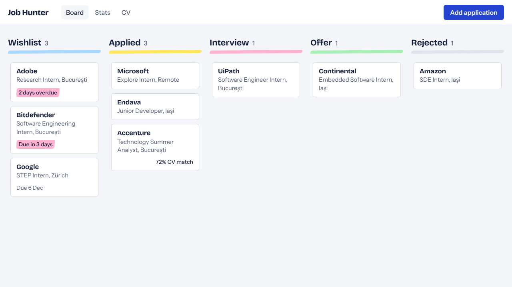
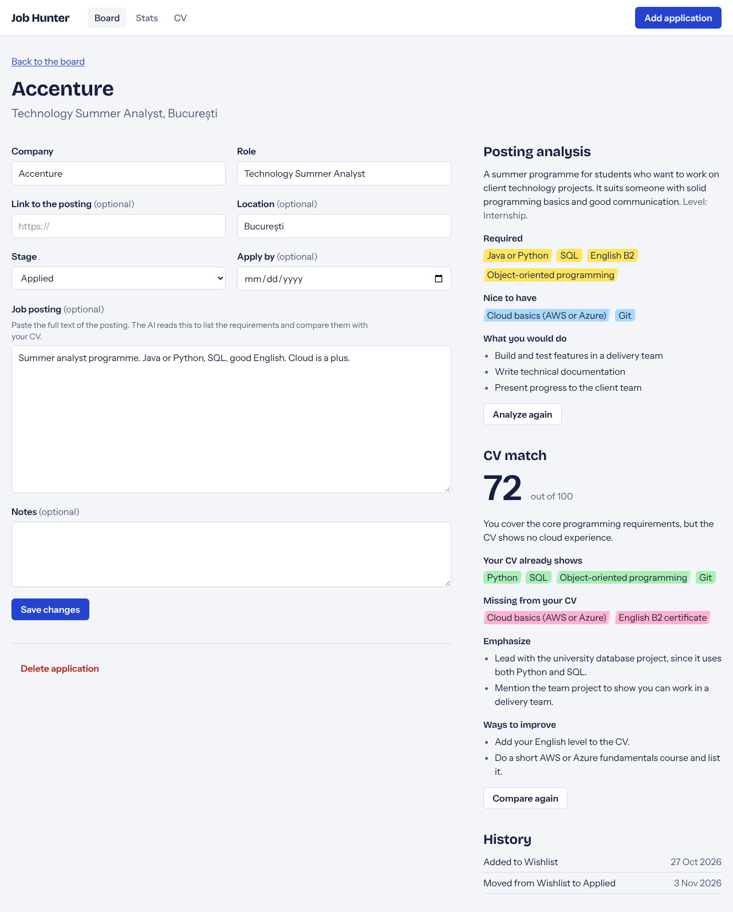
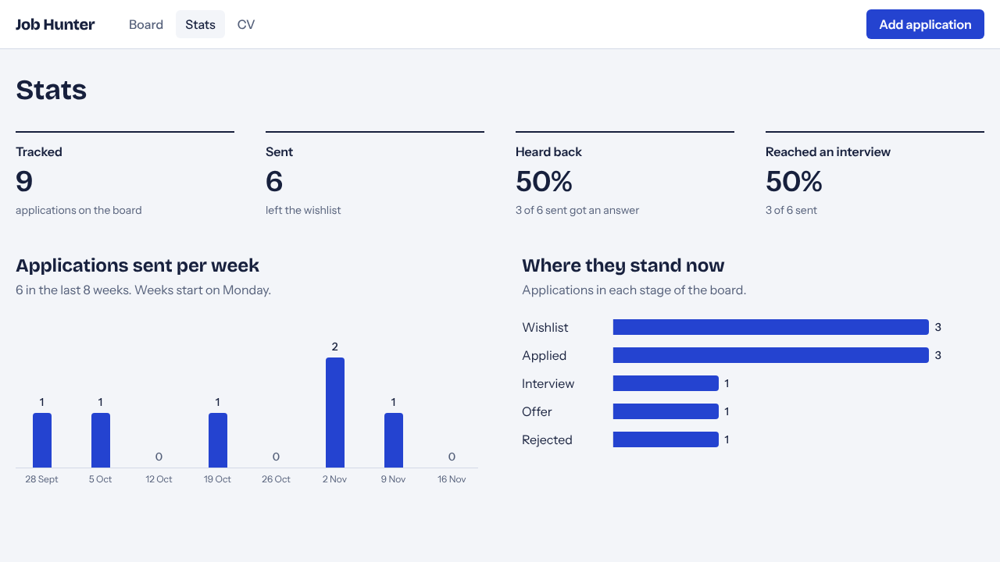

# Job Hunter

A job application tracker with an AI assistant. Keep every application on one
board, paste a job posting to get its requirements pulled out, and compare the
posting with your CV to see what you already cover and what is missing.



_Screenshots use demo data._

## What it does

- **Board.** One column per stage: Wishlist, Applied, Interview, Offer,
  Rejected. Drag a card to move it. Cards on the wishlist show how close the
  application deadline is.
- **Application page.** Company, role, link, location, deadline, notes and the
  full text of the posting, plus a history of every stage change.
- **Import from a link.** Paste the address of a job page and the company,
  role, location, deadline and posting text are filled in for you.
- **Weekly goal.** Set how many applications you want to send per week; the
  board shows this week's progress and how many weeks in a row you kept going.
- **Demo.** `/demo` shows a sample board without signing in.
- **Posting analysis.** Claude reads the pasted posting and returns a short
  summary, the level, the required and nice-to-have skills, and the day-to-day
  responsibilities.
- **CV match.** Upload your CV as a PDF once. For any posting, Claude scores the fit
  from 0 to 100 and lists the skills your CV shows, the ones it is missing,
  what to emphasize and how to improve the application.
- **Accounts.** Sign in with GitHub. Each person gets a private board; nobody
  can see or change anyone else's applications or CV.
- **Stats.** Applications sent per week, how many got an answer, how many
  reached an interview, and how many sit in each stage.





## Built with

- [Next.js 16](https://nextjs.org) (App Router, Server Components, Server
  Actions) and React 19, in TypeScript
- PostgreSQL with [Drizzle ORM](https://orm.drizzle.team)
- [Better Auth](https://better-auth.com) for sign-in with GitHub
- [unpdf](https://github.com/unjs/unpdf) to read the text out of an uploaded CV
- [Claude API](https://docs.claude.com) through the official TypeScript SDK,
  using structured outputs so every AI answer arrives as validated JSON
- Tailwind CSS 4
- [dnd kit](https://dndkit.com) for drag and drop
- Zod for validation, Vitest for tests, GitHub Actions for CI

## Run it on your computer

You need [Node.js 22 or newer](https://nodejs.org) and a PostgreSQL database.
The steps below start one with [Docker](https://www.docker.com); any other
Postgres works too, as long as `DATABASE_URL` points to it.

```bash
git clone https://github.com/Rares-Mihai/job-hunter.git
cd job-hunter
npm install

cp .env.example .env        # then open .env and fill it in
docker compose up -d        # starts Postgres
npm run db:migrate          # creates the tables
npm run dev                 # http://localhost:3000
```

### Setting up sign-in

Sign-in needs a GitHub "OAuth app", which tells GitHub that this app may ask
people to sign in. It is free and takes a few minutes:

1. On GitHub, open **Settings**, then **Developer settings**, then
   **OAuth Apps**, and choose **New OAuth App**.
2. Fill in:
   - Homepage URL: `http://localhost:3000`
   - Authorization callback URL:
     `http://localhost:3000/api/auth/callback/github`
3. Create the app, then generate a client secret.
4. Copy the client ID and the client secret into `.env` as `GITHUB_CLIENT_ID`
   and `GITHUB_CLIENT_SECRET`.
5. Put any long random text in `BETTER_AUTH_SECRET` (for example the output
   of `openssl rand -base64 32`).

When the app is deployed, create a second OAuth app with the deployed address
in both URLs, and set `BETTER_AUTH_URL` to that address.

### Turning on the AI features

The board, notes and stats work without any key. Posting analysis and CV match
need a Claude API key:

1. Create a key in the [Anthropic console](https://console.anthropic.com/).
   API usage is billed per request, separately from a Claude subscription.
2. Put it in `.env` as `ANTHROPIC_API_KEY`.
3. Restart `npm run dev`.

The app uses Claude Haiku by default, the fastest and cheapest model. To use
another one, set `ANTHROPIC_MODEL` in `.env`.

Because anyone with a GitHub account can sign in, AI requests are limited to
20 per person per day and 200 per day in total, so the API bill stays small.
Change the limits with `AI_DAILY_LIMIT_PER_USER` and `AI_DAILY_LIMIT_TOTAL`.

## Commands

| Command               | What it does                                                          |
| --------------------- | --------------------------------------------------------------------- |
| `npm run dev`         | Start the app for development                                         |
| `npm run build`       | Build for production                                                  |
| `npm start`           | Run the production build                                              |
| `npm test`            | Run the tests (set `TEST_DATABASE_URL` to include the database tests) |
| `npm run lint`        | Check code style                                                      |
| `npm run typecheck`   | Check types                                                           |
| `npm run db:generate` | Create a migration after changing `src/db/schema.ts`                  |
| `npm run db:migrate`  | Apply migrations to the database                                      |

## How the code is organized

```
src/
  app/                  Pages and server actions
    page.tsx            The board
    applications/       Add and edit an application
    stats/  cv/         Stats page, CV page
    sign-in/            Sign-in page
    actions.ts          Everything the browser can ask the server to change
  components/           Board, forms, AI panel
  db/                   Database schema and connection
  lib/
    auth.ts session.ts  Sign-in setup, and "who is signed in?"
    applications.ts     All database reads and writes, always for one user
    cv-pdf.ts           Reads the text out of an uploaded CV
    stats.ts            The numbers on the Stats page (pure functions)
    validation.ts       Form validation
    ai/                 Prompts, result schemas and the Claude API call
drizzle/                SQL migrations
```

A few decisions worth knowing about:

- **Every query is scoped to the signed-in user.** All data access goes
  through `src/lib/applications.ts`, where each function takes the user's id
  and filters on it. `src/lib/ownership.db.test.ts` checks against a real
  database that a second user can neither read nor change the first one's
  data.
- **The link importer only talks to the public internet.** A server that
  fetches addresses typed by users could be pointed at its own private
  network. `src/lib/posting-import.ts` checks the address before connecting,
  connects to exactly the address it checked, and checks again after every
  redirect.
- **Only the CV's text is stored,** never the PDF file.
- **AI answers are structured, not free text.** Each request names a schema
  (`src/lib/ai/schemas.ts`) and the API returns JSON matching it, which is
  validated again before it is stored.
- **Pasted text is treated as data.** Postings and CVs are wrapped in tags and
  the model is told to ignore any instructions inside them.
- **Links are restricted to http and https,** because a saved link is rendered
  as a clickable `<a>`.
- **AI results are cleared when their input changes.** Editing the posting
  drops its analysis and match; saving a different CV drops all match scores.

## Putting it online

These steps use free plans. They have not been run for this repository yet.

1. **Database.** Create a Postgres database at [Neon](https://neon.tech) and
   copy its connection string.
2. **Hosting.** Import the repository at [Vercel](https://vercel.com). It
   picks up the `vercel-build` script, which creates the database tables and
   then builds the app.
3. **Settings.** In the Vercel project, add the variables from `.env.example`:
   `DATABASE_URL`, `BETTER_AUTH_SECRET`, `BETTER_AUTH_URL` (the address Vercel
   gives the site), `GITHUB_CLIENT_ID`, `GITHUB_CLIENT_SECRET` and, for the AI
   features, `ANTHROPIC_API_KEY`.
4. **Sign-in.** Create a second GitHub OAuth app for the deployed address,
   with the callback URL `https://YOUR-ADDRESS/api/auth/callback/github`.

## Not built yet

- Reading scanned (image-only) CVs.
- Sites that show a posting only after login cannot be imported from a link.
